Find indices of 2 elements in a slice that add up to `target`:



Naive solution -- O(n^2):

```go
for i := range nums {
    for j := range nums {
        if nums[i] + nums[j] == target && i != j {
            return []int{i, j}
        }
    }
}
```

Optimized solution -- O(n):

- Create a hashmap: num : idx
- For each `num`, calculate `candidate = target - num`
- Check if `candidate` is in map -- ~O(1)
- If so, return the indices

```go
mp := make(map[int]int, len(nums))
for i, v := range nums {
    mp[v] = i
}

var candidate int
for i, v := range nums {
    candidate = target - v
    if idx, ok := mp[candidate]; ok && i != idx {
        return []int{i, idx}
    }
}

return []int{-1, -1}

```
